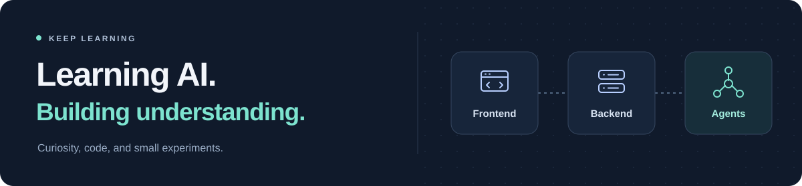
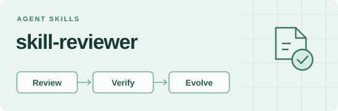
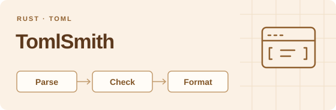

<h1 align="center">Hi, I'm Nirvana 👋</h1>

  

I'm currently learning about **AI** and exploring how it fits into useful software. My interests span **frontend development**, **backend development**, and the ideas behind **AI agents**.

## What I'm working on

Learning through the tools I build — from reviewing agent skills to working with programming languages and developer workflows.

<table>
  <tr>
    <td width="50%" valign="top">
      
      
<strong>Evidence-backed review for Agent Skills.</strong>

      
Review skill packages, compare candidates with a baseline, and inspect the traces behind the results.

      
<code>Agent Skills</code> <code>Evals</code> <code>Developer tools</code>

      
<a href="https://github.com/Nirvana-Jie/skill-reviewer">Explore skill-reviewer →</a>

    </td>
    <td width="50%" valign="top">
      
      
<strong>TOML tooling, from library to editor.</strong>

      
Parse, check, and format TOML 1.0 and 1.1 with Rust — through a library, a CLI, and an LSP server.

      
<code>Rust</code> <code>TOML</code> <code>LSP</code>

      
<a href="https://github.com/tomlsmith/tomlsmith">Explore TomlSmith →</a>

    </td>
  </tr>
</table>

  
More experiments

  <ul>
    <li><a href="https://github.com/Nirvana-Jie/dsh-session-tree"><strong>dsh-session-tree</strong></a> — exploring session lineage, forks, and subagents in DeepSeek Harness.</li>
    <li><a href="https://github.com/Nirvana-Jie/lottie-miniprogram-v2"><strong>lottie-miniprogram-v2</strong></a> — a Canvas v2 Lottie player for Douyin Mini Apps and compatible runtimes.</li>
  </ul>

## Tech stack

| Area | Technologies & interests |
| --- | --- |
| Frontend | TypeScript · JavaScript · HTML · CSS · React · Vue |
| Backend | Node.js · APIs and services |
| Systems & tooling | Rust · CLI tools · Language tooling |

## Currently learning

- **AI & LLMs** — the fundamentals and how to build practical applications around them.
- **Agents** — how they use tools, manage context, and work through tasks.
- **Putting it together** — connecting interfaces and backend services with AI capabilities.

I learn through small experiments, hands-on practice, and following my curiosity.

Keep learning. Keep building.

